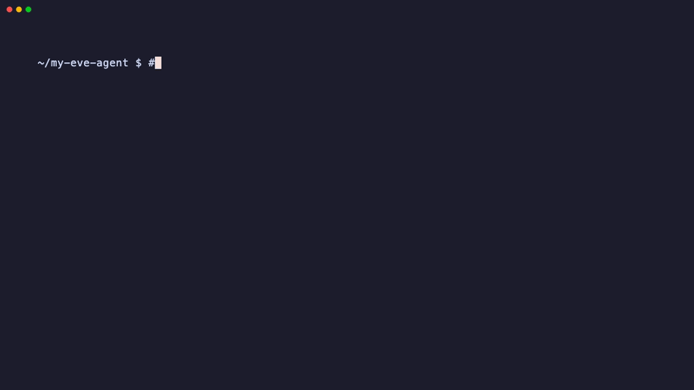

# Eden

[](https://www.npmjs.com/package/@moinulmoin/eden)
[](https://github.com/moinulmoin/eden/actions/workflows/ci.yml)
[](./LICENSE)

Deploy an existing [Vercel Eve](https://github.com/vercel/eve) agent to your
own Cloudflare account with one command. No rewrite.
[eden.ideaplexa.com](https://eden.ideaplexa.com)



Eden installs the project's pinned pnpm lockfile, runs its project-local Eve
executable, packages the real Node/Nitro server into a Cloudflare Container,
and puts a Worker in front of it. Your Eve project stays exactly as you wrote
it: Eden never rewrites it or swaps out its providers and services.

What you get on your own account:

- your Eve server in a Cloudflare Container, with a Worker and a `workers.dev`
  URL in front
- `eden deploy` again updates in place: same URL, new code, every
  conversation's files kept
- the container sleeps when idle and wakes on the next request; standard cron
  schedules still fire while it sleeps
- `eden destroy` removes exactly what Eden created, nothing else

## Quick start

From inside a pnpm Eve project, with Docker running:

```sh
npx wrangler@4.147.0 login
npx @moinulmoin/eden deploy --env-file ~/.config/my-agent/preview.env
```

The env file holds your model key and auth secrets and lives outside the
project. Deploy prints the live URL. Run the same command again to ship a
change. New to Eve, or starting from `eve init`? Check
[Requirements](#requirements) first.

## Install

`npx @moinulmoin/eden` needs no install. For a global `eden` command, use npm:

```sh
npm install --global @moinulmoin/eden@0.7.3
```

Or pnpm:

```sh
pnpm add --global @moinulmoin/eden@0.7.3
```

Or Bun:

```sh
bun add --global @moinulmoin/eden@0.7.3
```

Confirm the installation:

```sh
eden --version
```

Users install only `@moinulmoin/eden`; its companion packages are resolved
automatically. Bun is supported as an installer only. Node `>=24.17.0` remains
the Eden runtime, so do not force the CLI through `bunx --bun`.

Using a coding agent (Claude Code, Codex, Cursor, and others)? Install Eden's
skill so it knows how to deploy, update, and remove Eve agents with Eden:

```sh
npx skills add moinulmoin/eden
```

## Requirements

- macOS or Linux
- Node `>=24.17.0`
- a Cloudflare account on the Workers Paid plan ($5/month, required for
  Containers)
- Wrangler authentication:

  ```sh
  npx wrangler@4.147.0 login
  ```

- Docker or OrbStack with Linux/amd64 container support
- an Eve project with an exact `packageManager: "pnpm@..."` entry and the
  matching root `pnpm-lock.yaml`
- `just-bash` as a production dependency (`pnpm add just-bash`). Eve's
  default sandbox needs it inside Eden's builder, and `eve init` does not
  add it.
- the providers, credentials, databases, Workflow World, and external services
  the Eve project already needs

Bun project lockfiles and native Windows are not supported yet.

### Starting from a fresh Eve project

Eden has been deployed live with Eve `0.68.0`, `0.79.1`, and `0.81.0`, and Eve
`0.82.0` passes `eden preflight`. To start on the latest live-validated
release:

```sh
npx eve@0.81.0 init my-agent --non-interactive
cd my-agent
npm pkg set packageManager="pnpm@11.21.0" dependencies.eve="0.81.0"
rm package-lock.json
```

Eve's initializer uses npm when invoked this way; Eden requires pnpm instead.
Before installing, create `pnpm-workspace.yaml` (or merge these settings into
an existing file):

```yaml
minimumReleaseAgeExclude:
  - eve@0.81.0
ignoredOptionalDependencies:
  - "@mongodb-js/zstd"
  - node-liblzma
```

Then install the sandbox dependency and generate the pnpm lockfile:

```sh
pnpm add just-bash
```

The optional native archive packages above are not needed by this sandbox;
without this policy pnpm 11 stops with `ERR_PNPM_IGNORED_BUILDS`. If you change
the policy after an install, regenerate the lockfile with
`pnpm install --no-frozen-lockfile`.

Replace the production placeholder in `agent/channels/eve.ts` with your real
[Eve authenticator](https://eve.dev/docs/guides/auth-and-route-protection)
before deploying: the generated Vercel/localhost authenticators do not grant
access on Cloudflare. Put your model provider key (for an AI Gateway model,
`AI_GATEWAY_API_KEY`) and authentication secrets in an environment file outside
the project.

## Deploy

From inside the Eve project:

```sh
npx @moinulmoin/eden deploy --env-file ~/.config/my-agent/preview.env
```

With no other flags, `deploy` uses the current directory, the `preview`
environment, and a target name derived from the project's `package.json` name.
Every check runs inline before anything changes on Cloudflare. A successful
deploy prints progress lines, then the target, the Eve version, and the public
`workers.dev` URL on its own line.

Eden passes env-file values through its protected deployment path. They are
never placed in command arguments, image layers, generated artifacts, or
normal logs.

Explicit selectors work too. `--name` is required for `--env production` and
for `destroy`:

```sh
eden deploy \
  --project ./my-eve-app \
  --env preview \
  --name my-eve-preview \
  --env-file ~/.config/my-eve-app/preview.env
```

**Ship a change** by running the same deploy again. Eden updates the target it
owns in place: same Worker and URL, the new code, and every conversation's
sandbox files carried into the new Container. A target Eden does not own fails
with `VAL-CLI-007-TARGET-CONFLICT` instead of being overwritten.

**Remove it** when finished:

```sh
eden destroy --name my-eve-preview
```

Destroy always requires an explicit `--name` and Eden's ownership record. It
verifies the remote identity first and never touches similarly named
resources.

**Troubleshoot** with the read-only `eden preflight`, which builds and boots the
agent locally and checks Cloudflare access without changing anything. All
three commands accept `--json`.

### What stays with your Eve project

Eden deploys; your Eve project still owns its:

- model providers and credentials
- databases, queues, and external APIs
- channels, schedules, authentication, and authorization
- Workflow World (the sandbox runs as `just-bash`; see [Limits](#limits))

## Limits

- **Sandbox:** the agent's shell is `just-bash`, a simulated shell, not a real
  Linux VM like Vercel Sandbox. Files, `grep`/`sed`/`jq`/`sqlite3`, and `curl`
  work; `python`, `git`, `npm`, and other real programs do not. The sandbox has
  unrestricted internet access.
- **Custom sandboxes:** a project that picks its own sandbox in
  `agent/sandbox.ts` (Docker, microsandbox, or Vercel Sandbox) fails at build,
  and `agent/sandbox/Dockerfile` silently falls back to `just-bash`.
- **State:** container disk survives sleep, and updates carry every
  conversation's files (up to 1 GiB compressed) through Durable Object storage.
  Local Workflow World state resets on update, and Eden warns about it. To keep
  in-flight runs across updates, use the Postgres World (any direct, unpooled
  Postgres); see [docs/deploy.md](docs/deploy.md#durable-state-postgres-world).
- **Schedules:** standard 5-field cron schedules fire while the Container sleeps
  (a Cloudflare Cron Trigger wakes it); others only run while it is awake. See
  [docs/deploy.md](docs/deploy.md#schedules).
- **Scale:** one Container instance per agent (`standard-1`: 1/2 vCPU, 4 GiB),
  `workers.dev` URL only. No horizontal scaling or custom domains yet.

## What we found running Eve on Cloudflare

Things that differ from Vercel, and what Eden does about each:

- **Container disk is wiped when a container stops.** Eden snapshots the disk
  before the container sleeps and restores it on wake. Cloudflare deletes a
  snapshot after 30 days without a wake.
- **Cloudflare stops an idle container within 6 hours.** Eden puts it to sleep
  after 1 hour without requests (`EDEN_EVE_CONTAINER_SLEEP_AFTER`, up to
  `345m`) so the snapshot always happens first.
- **An update starts a new container from a new image.** Eden copies every
  conversation's sandbox files into it before it serves requests.
- **Eve's `just-bash` sandbox refuses to resume a conversation after a skill
  change** ([eve#4440](https://github.com/vercel/eve/issues/4440)). Eden applies
  a small temporary fix at build time, only for Eve versions it recognizes,
  until Eve ships its own.
- **Eve prepares its sandbox at build time, on the machine that builds.** A
  real Linux sandbox (microsandbox or Docker) needs KVM or a Docker daemon
  there; Eden's builder has neither, so agents get `just-bash`. microsandbox
  does run inside Cloudflare's container, but preparing it there adds about 7
  minutes to every deploy and update, so Eden does not use it yet.
- **Waking a sleeping agent takes about 10–15 seconds**, mostly Eve's server
  starting up. The container itself starts in about a second.

## Commands

| Command | Purpose |
| --- | --- |
| `eden deploy` | Deploy an Eve project to one exact target, or update a target Eden owns in place |
| `eden destroy` | Remove one exact Eden-owned Eve deployment |
| `eden preflight` | Build and check an Eve project locally without changing anything on Cloudflare |

Run `eden <command> --help` for options and `eden --version` for the installed
version.

## Develop from source

The repository is a pnpm workspace with TypeScript project references. It works
without Turbo or Turborepo.

```sh
corepack enable
pnpm install --frozen-lockfile
pnpm run build
pnpm run typecheck
pnpm run lint
pnpm run test
```

After the build, invoke the source-checkout CLI with:

```sh
node packages/cli/dist/index.js --help
```

The landing page at eden.ideaplexa.com lives in `site/` (Astro). Run it with
`pnpm --filter @moinulmoin/eden-site dev`.

## Documentation

- [Documentation index](./docs/README.md): every guide
- [Installation](./docs/install.md): Node, npm/pnpm/Bun, Cloudflare, containers,
  updates, uninstallation, and PATH problems
- [Deploy](./docs/deploy.md): preview deployment, verification, exact cleanup,
  durability, and current limits
- [How Eden works](./docs/how-it-works.md): the Worker, Durable Object, and
  Container, deploy steps, sleep and wake, updates, and where data lives
- [Security](./docs/security.md): secrets, what is public, the sandbox, and
  what Eden can change in your account
- [FAQ](./docs/faq.md): cost, project changes, timings, and comparisons
- [Reference](./docs/reference.md): commands, flags, env-file rules, and what
  Eden creates
- [Troubleshooting](./docs/troubleshooting.md): failure and warning codes
  with fixes
- [Eve compatibility](./docs/eve-compatibility.md): every Eve version Eden has
  been checked against, and how
- [Validation](./docs/validation.md): maintainer runbook for the Eve
  compatibility gate and deployed cleanup checks

## License

Apache-2.0. See [`LICENSE`](./LICENSE) and [`NOTICE`](./NOTICE) for the
Cloudflare Containers attribution.
