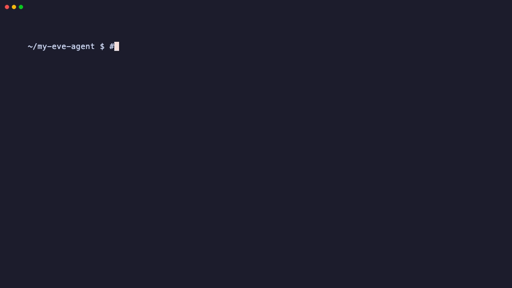

# Eden

[](https://www.npmjs.com/package/@moinulmoin/eden)
[](https://github.com/moinulmoin/eden/actions/workflows/ci.yml)
[](./LICENSE)

Deploy an existing [Vercel Eve](https://github.com/vercel/eve) agent to your
own Cloudflare account with one command. No rewrite.
[eden.ideaplexa.com](https://eden.ideaplexa.com)



Eden installs the project's npm or pinned pnpm lockfile, runs its project-local Eve
executable, packages the real Node/Nitro server into a Cloudflare Container,
and puts a Worker in front of it. Your Eve project stays exactly as you wrote
it: Eden never rewrites it or swaps out its providers and services.

What you get on your own account:

- your Eve server in a Cloudflare Container, with a Worker and a `workers.dev`
  URL in front
- `eden deploy` again updates in place: same URL, new code, every
  conversation's files kept
- the container sleeps when idle and wakes on the next request; standard cron
  schedules still fire while it sleeps
- `eden destroy` removes only what Eden created; Cloudflare may keep some
  [registry objects](./docs/troubleshooting.md#eve_registry_objects_kept)

## Quick start

From inside an npm or pnpm Eve project, with Docker running:

```sh
npx cf@1.0.0-rc.6 auth login
npx @moinulmoin/eden preflight --env-file ~/.config/my-agent/preview.env
npx @moinulmoin/eden deploy --env-file ~/.config/my-agent/preview.env
```

A project straight from `eve init` needs setup before it can serve requests
on Cloudflare. Follow
[Starting from a fresh Eve project](#starting-from-a-fresh-eve-project).
`preflight` changes nothing on Cloudflare and reports the setup problems
it can detect before building.

The env file holds your model key and auth secrets and lives outside the
project. Deploy prints the live URL. Run the same command again to ship a
change.

## Install

`npx @moinulmoin/eden` needs no install. For a global `eden` command, use npm:

```sh
npm install --global @moinulmoin/eden
```

Or pnpm:

```sh
pnpm add --global @moinulmoin/eden
```

Or Bun:

```sh
bun add --global @moinulmoin/eden
```

Confirm the installation:

```sh
eden --version
```

Users install only `@moinulmoin/eden`; its companion packages are resolved
automatically. Bun is supported as an installer only. Node `^24.22.0 || ^26.12.0` remains
the Eden runtime, so do not force the CLI through `bunx --bun`.

### With a coding agent

Eden ships a skill for coding agents (Claude Code, Codex, Cursor, and others):
how to get an Eve project ready for Cloudflare, then deploy, update, and remove
it. Point the agent at the copy that matches your installed CLI:

```sh
npx @moinulmoin/eden skill
```

Or install it into the agent's skills folder:

```sh
npx skills add moinulmoin/eden
```

The skill's core loop is `eden preflight --json`: fix each check and warning
by its `remediation`, repeat until clean, then deploy. Preflight changes
nothing on Cloudflare.

## Requirements

- macOS or Linux
- Node `^24.22.0 || ^26.12.0`
- a Cloudflare account on the Workers Paid plan ($5/month, required for
  Containers)
- a sign-in with Cloudflare's `cf` CLI, or `CLOUDFLARE_API_TOKEN` set:

  ```sh
  npx cf@1.0.0-rc.6 auth login
  ```

  Eden 0.14 and earlier used the Wrangler login. `cf` does not read it, so
  sign in once after upgrading. A new `cf` login also asks for billing read
  and write access, which Eden never uses. A login you already have keeps
  its scopes, and you can revoke `cf`'s access under
  [Manage OAuth authorizations](https://dash.cloudflare.com/?to=/profile/access-management/authorization) in the Cloudflare dashboard.

- Docker or OrbStack with Linux/amd64 container support
- an Eve project with one root `package-lock.json`, or an exact
  `packageManager: "pnpm@..."` entry and matching root `pnpm-lock.yaml`
- Eve `>=0.91.0`; `preflight` and `deploy` reject older versions with
  `EVE_VERSION_UNSUPPORTED`.
- `just-bash` as a production dependency (`npm add just-bash` or `pnpm add just-bash`).
  Explicitly select `JustBashSandbox` as shown
  [below](#starting-from-a-fresh-eve-project); the production default no longer
  falls back to it.
- the providers, credentials, databases, Workflow World, and external services
  the Eve project already needs

Bun project lockfiles and native Windows are not supported yet.

npm projects deploy without package-manager conversion: Eden defaults to npm
`11.13.0`, or uses an exact `npm@<major>.<minor>.<patch>` pin (npm 7 or newer).
It uses frozen `npm ci --ignore-scripts` installs with a v2/v3
`package-lock.json`; dependency lifecycle scripts do not run, and preflight
names production dependencies that have one.
Keep only one package manager's lockfile; mixed lockfiles are
rejected. `.npmrc` is excluded from build layers, so private registries and
installs that require project `.npmrc` configuration are not supported.

### Starting from a fresh Eve project

Eden needs Eve `0.91.0` or later; see [Eve compatibility](./docs/eve-compatibility.md)
for the tested versions, the World each one needs, and how to redeploy an
older project unchanged.

To start a new project on Eve `1.5.0`, the latest release Eden tests:

```sh
npx eve@1.5.0 init my-agent --non-interactive
cd my-agent
npm pkg set dependencies.eve="1.5.0"
npm install just-bash @moinulmoin/eden-world-cloudflare
```

Then make the five changes below. They are the same ones the
[coding-agent skill](#with-a-coding-agent) makes.

**1. Sandbox.** Explicitly select the supported sandbox in `agent/sandbox.ts`. If the project
has an `agent/sandbox/` folder (for example `agent/sandbox/workspace/`), put
the module in `agent/sandbox/sandbox.ts` instead; Eve ignores or rejects
`agent/sandbox.ts` next to that folder:

```ts
import { defineSandbox } from 'eve/sandbox';
import { JustBashSandbox } from 'eve/sandbox/just-bash';

export const environment = JustBashSandbox.environment();
export default defineSandbox(() => environment.open());
```

Eve's default sandbox selects Vercel Sandbox or Docker, neither of which is
available inside Eden's isolated builder, so Eden rejects it early with these
setup instructions.

Keep the generated `package-lock.json`; Eden installs it with `npm ci` without
converting the project to pnpm.

**2. Channel auth.** Replace the generated auth in `agent/channels/eve.ts`
with your real
[Eve authenticator](https://eve.dev/docs/guides/auth-and-route-protection):
the generated Vercel/localhost authenticators do not grant access on
Cloudflare. A bearer token read from the env file is enough to start:

```ts
import { localDev, type AuthFn } from "eve/channels/auth";
import { eveChannel } from "eve/channels/eve";

const authenticate: AuthFn<Request> = (request) => {
  const expected = process.env.AGENT_AUTH_TOKEN;
  if (!expected || request.headers.get("authorization") !== `Bearer ${expected}`) {
    return null;
  }
  return {
    attributes: {},
    authenticator: "bearer-token",
    principalId: "app-client",
    principalType: "app",
  };
};

export default eveChannel({ auth: [authenticate, localDev()] });
```

**3. Workflow World.** Eve's default local World loses sessions and pending
approvals on every update. For durable state without a database, select the
Cloudflare World in `agent/agent.ts`:

```ts
export default defineAgent({
  model: "openai/gpt-6-luna-fast",
  reasoning: "high",
  experimental: { workflow: { world: "@moinulmoin/eden-world-cloudflare" } },
});
```

To use Postgres instead, see
[docs/deploy.md](docs/deploy.md#durable-state-postgres-world).

**4. Env file.** Put the model key and the auth token in a file outside the
project. A string model such as `"openai/gpt-6-luna-fast"` goes through Vercel
AI Gateway and needs `AI_GATEWAY_API_KEY`; a direct provider needs its own
key instead. Use exactly `KEY=value` per line, without quotes:

```sh
mkdir -p ~/.config/my-agent && chmod 700 ~/.config/my-agent
touch ~/.config/my-agent/preview.env && chmod 600 ~/.config/my-agent/preview.env
```

```text
AI_GATEWAY_API_KEY=<your key>
AGENT_AUTH_TOKEN=<a long random string>
```

**5. Preflight.** Check the project before the first deploy:

```sh
npx @moinulmoin/eden preflight --env-file ~/.config/my-agent/preview.env
```

Eden writes its build output and deployment records to `.eden/` in the
project. Do not commit it: one build was 245 MB in a test, and its files
record absolute paths on your machine. Add it to `.gitignore`:

```sh
printf '\n.eden/\n' >> .gitignore
```

Updates and `destroy` need this folder. Run them from the project root that
holds it, or select that root with `--project`. If it is lost, see
[The `.eden/` folder is lost](./docs/troubleshooting.md#the-eden-folder-is-lost).

## Deploy

From inside the Eve project:

```sh
npx @moinulmoin/eden deploy --env-file ~/.config/my-agent/preview.env
```

With no other flags, `deploy` uses the current directory, the `preview`
environment, and a target name derived from the project's `package.json` name.
Every check runs inline before anything changes on Cloudflare. A successful
deploy prints progress lines, then the target, the Eve version, and the public
`workers.dev` URL on its own line.

Eden passes env-file values through its protected deployment path. They are
never placed in command arguments, image layers, generated artifacts, or
normal logs.

Explicit selectors work too. `--name` is required for `--env production` and
for `destroy`:

```sh
eden deploy \
  --project ./my-eve-app \
  --env preview \
  --name my-eve-preview \
  --env-file ~/.config/my-eve-app/preview.env
```

**Ship a change** by running the same deploy again. Eden updates the target it
owns in place: same Worker and URL, the new code, and every conversation's
sandbox files carried into the new Container. A target Eden does not own fails
with `VAL-CLI-007-TARGET-CONFLICT` instead of being overwritten.

**Remove it** when finished:

```sh
eden destroy --name my-eve-preview
```

Destroy always requires an explicit `--name` and Eden's ownership record. It
verifies the remote identity first and never touches similarly named
resources. Cloudflare's registry keeps some objects destroy tries to delete,
such as container snapshots; see
[`EVE_REGISTRY_OBJECTS_KEPT`](./docs/troubleshooting.md#eve_registry_objects_kept).
A kept snapshot still holds the agent's files until Cloudflare removes it,
which it documents as 30 days after the snapshot was created or last
restored.

**Troubleshoot** with `eden preflight`, which builds and boots the agent
locally and checks Cloudflare access without changing anything on Cloudflare.
With the Postgres World it also runs the World's idempotent schema migration
against your database. All
three commands accept `--json`.

### What stays with your Eve project

Eden deploys; your Eve project still owns its:

- model providers and credentials
- databases, queues, and external APIs
- channels, schedules, authentication, and authorization
- Workflow World (the sandbox runs as `just-bash`; see [Limits](#limits))

## Limits

- **Sandbox:** the agent's shell is `just-bash`, a simulated shell, not a real
  Linux VM like Vercel Sandbox. Files, `grep`/`sed`/`jq`/`sqlite3`, and `curl`
  work; `python`, `git`, `npm`, and other real programs do not. The sandbox has
  unrestricted internet access.
- **Sandbox selection:** Eden supports only `just-bash`, including the explicit
  `JustBashSandbox` module above. Docker, Vercel Sandbox, and other providers
  are unsupported. A sandbox Dockerfile is not a way to run a Linux VM in Eden.
  microsandbox applies only to older Eve releases; Eve `0.83.0` removed it.
- **State:** container disk survives sleep, and updates carry every
  conversation's files (up to 1 GiB compressed) through Durable Object storage.
  **Eve upgrades keep sessions on the Cloudflare World:** when a deploy changes
  the Eve version, the old version keeps running and each session moves to the
  new one on its next message, with its history and files (verified live on
  `0.83.0` → `0.91.0` → `1.0.0-rc.3`). This needs the current
  `@moinulmoin/eden-world-cloudflare`; with an older World or the Postgres
  World, old sessions return HTTP 409 `session_stranded` after an Eve upgrade
  and users start new ones. Skill and code updates on the same Eve version
  keep sessions.
  **Security exception:** the next deploy retires kept versions without World
  RPC authentication, including versions from Eden ≤`0.9.0`, even with live
  sessions. Those sessions end and their next message fails; users must start
  new ones. Eve may show the generic "Failed to send the session message" error.
  Local Workflow World state resets on update, and Eden warns about it. To keep
  in-flight runs across updates, use the Postgres World (any direct, unpooled
  Postgres); see [docs/deploy.md](docs/deploy.md#durable-state-postgres-world).
- **Schedules:** standard 5-field cron schedules fire while the Container sleeps
  (a Cloudflare Cron Trigger wakes it); others only run while it is awake. See
  [docs/deploy.md](docs/deploy.md#schedules).
- **Scale:** one Container instance per agent (`standard-1`: 1/2 vCPU, 4 GiB),
  plus one per older Eve version still holding sessions after an upgrade
  (they sleep when idle; at most 10 versions). `workers.dev` URL only. No
  horizontal scaling or custom domains yet.

## What we found running Eve on Cloudflare

Things that differ from Vercel, and what Eden does about each:

- **Container disk is wiped when a container stops.** Eden snapshots the disk
  before the container sleeps and restores it on wake. Cloudflare deletes a
  snapshot after 30 days without a wake.
- **Cloudflare stops an idle container within 6 hours.** Eden puts it to sleep
  after 1 hour without requests (`EDEN_EVE_CONTAINER_SLEEP_AFTER`, up to
  `345m`) so the snapshot always happens first.
- **An update starts a new container from a new image.** Eden copies every
  conversation's sandbox files into it before it serves requests.
- **Eve prepares its sandbox at build time, on the machine that builds.** A
  real Linux sandbox (microsandbox or Docker) needs KVM or a Docker daemon
  there; Eden's builder has neither, so agents get `just-bash`. Historical
  microsandbox preparation in the Container added about 7 minutes per deploy;
  Eve `0.83.0` removed microsandbox.
- **Waking a sleeping agent takes about 10–15 seconds**, mostly Eve's server
  starting up. The container itself starts in about a second.

## Commands

| Command | Purpose |
| --- | --- |
| `eden deploy` | Deploy an Eve project to one exact target, or update a target Eden owns in place |
| `eden destroy` | Remove one exact Eden-owned Eve deployment |
| `eden preflight` | Build and check an Eve project locally without changing anything on Cloudflare |
| `eden skill` | Print the coding-agent skill for this CLI version |

Run `eden <command> --help` for options and `eden --version` for the installed
version.

## Telemetry

Eden sends one anonymous usage event when `eden preflight`, `eden deploy`,
or `eden destroy` ends. It is on by default. It tells the maintainer which
commands people run, which ones fail and with which code, and which Eden,
Eve, and Node versions are still in use. `--help`, `--version`, and
`eden skill` send nothing.

Turn it off with either variable:

```sh
export EDEN_TELEMETRY=0   # false and off work too
export DO_NOT_TRACK=1
```

When it is off, Eden sends nothing and creates no install ID.

The first time Eden sends, it prints a three-line notice on stderr. It
prints nothing else, and nothing on stdout, so `--json` output stays one
JSON object. Telemetry reads no project file: the Eve version and World come
from what the command already resolved. Its DNS lookup, connection, and
request end within one second of the command's end; then Eden closes what is
still open and exits. A send is tried once and dropped if it fails. It never
changes the exit code. When `telemetry.json` or its folder is a symbolic
link, unreadable, or not a valid Eden file, Eden sends nothing and leaves it
as it is.

The event has exactly these fields:

| Field | What it holds |
| --- | --- |
| `schema` | `1`, the version of this event shape |
| `installId` | A random UUID made the first time Eden sends, kept in `$XDG_CONFIG_HOME/eden/telemetry.json` (`~/.config/eden/telemetry.json` when `XDG_CONFIG_HOME` is unset or not an absolute path). It is not derived from anything, but it stays the same, so it links the events from one machine. Delete the file to get a new one |
| `command` | `preflight`, `deploy`, or `destroy` |
| `edenVersion` | The Eden version, such as `0.15.2` |
| `exitCode` | `0` or `1` |
| `failureCode` | One of Eden's own failure codes, such as `EVE_PREFLIGHT_FAILED`, from a fixed list the collector shares; `other` for any other code; `null` when the command succeeded |
| `duration` | One of `<10s`, `10s-1m`, `1m-5m`, `5m-15m`, `15m-1h`, `>1h` |
| `os` | `darwin`, `linux`, `win32`, or `other` |
| `arch` | `arm64`, `x64`, or `other` |
| `nodeMajor` | The major version of Node, such as `24` |
| `eveVersion` | The Eve version the command itself resolved, as the project declares it: from the build for preflight and deploy, from the deployment record for destroy, such as `1.3.0` or `1.0.0-rc.7`. It is sent only when it is a plain release, or a prerelease labeled `alpha`, `beta`, `rc`, `canary`, `next`, or `preview`, with numbers of at most three digits. Any other version, and a command that stopped before resolving one, sends `other` |
| `world` | `cloudflare`, `postgres`, `local`, or `other`: the World the preflight or deploy build selected. `other` for any other World, for destroy, and for a command that stopped before the build |
| `ci` | `true` when one of `CI`, `CONTINUOUS_INTEGRATION`, `GITHUB_ACTIONS`, `GITLAB_CI`, `BUILDKITE`, `CIRCLECI`, `TRAVIS`, `JENKINS_URL`, `TEAMCITY_VERSION`, `TF_BUILD`, `BITBUCKET_BUILD_NUMBER`, or `CODEBUILD_BUILD_ID` is set to anything but an empty value, `0`, or `false`. No value is sent |

Eden never sends project, target, or Worker names, Cloudflare account or
user IDs, emails, URLs, file paths, hostnames, the values of environment
variables, error messages, or anything from the env file or secrets. It does
not hash any of these and send the hash instead: they are not sent at all.

The event goes in an HTTPS `POST` to
`https://telemetry.eden.ideaplexa.com/v1/events`, a Cloudflare Worker whose
code is in [`telemetry/`](./telemetry). It accepts only this exact shape, up
to 1 KB, and writes it to a Workers Analytics Engine dataset on the
maintainer's Cloudflare account, which keeps it for three months. The Worker
does not store or log the IP address, headers, or user agent, and its Workers
Logs are off. `EDEN_TELEMETRY_URL` sends the event to another endpoint
instead, for tests or your own collector.

## Develop from source

The repository is a pnpm workspace with TypeScript project references. It works
without Turbo or Turborepo.

```sh
corepack enable
pnpm install --frozen-lockfile
pnpm run build
pnpm run typecheck
pnpm run lint
pnpm run test
```

After the build, invoke the source-checkout CLI with:

```sh
node packages/cli/dist/index.js --help
```

The landing page at eden.ideaplexa.com lives in `site/` (Astro). Run it with
`pnpm --filter @moinulmoin/eden-site dev`. The telemetry collector lives in
`telemetry/`; see [its README](./telemetry/README.md).

## Documentation

- [Documentation index](./docs/README.md): every guide
- [Installation](./docs/install.md): Node, npm/pnpm/Bun, Cloudflare, containers,
  updates, uninstallation, and PATH problems
- [Deploy](./docs/deploy.md): preview deployment, verification, exact cleanup,
  durability, and current limits
- [How Eden works](./docs/how-it-works.md): the Worker, Durable Object, and
  Container, deploy steps, sleep and wake, updates, and where data lives
- [Security](./docs/security.md): secrets, what is public, the sandbox,
  what Eden can change in your account, and telemetry
- [FAQ](./docs/faq.md): cost, project changes, timings, and comparisons
- [Reference](./docs/reference.md): commands, flags, env-file rules, and what
  Eden creates
- [Troubleshooting](./docs/troubleshooting.md): failure and warning codes
  with fixes
- [Eve compatibility](./docs/eve-compatibility.md): every Eve version Eden has
  been checked against, and how
- [Validation](./docs/validation.md): maintainer runbook for the Eve
  compatibility gate and deployed cleanup checks

## License

Apache-2.0. See [`LICENSE`](./LICENSE) and [`NOTICE`](./NOTICE) for the
Cloudflare Containers attribution.
