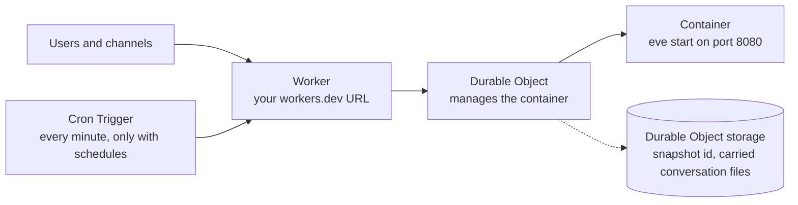

# How Eden works

Eve is built to run on Vercel. An Eve app is a long-running Node server
(`eve start`), a sandbox where the agent runs shell commands, and a Workflow
World that stores sessions, runs, and steps. A Cloudflare Worker cannot run a
long-running Node server, but a Cloudflare Container can. Eden runs your real
Eve server, unchanged, inside a Cloudflare Container on your own account, and
puts a small Worker in front of it.

This page explains the moving parts. For commands and flags see the
[reference](./reference.md); for the step-by-step guide see
[Deploy an existing Eve project](./deploy.md).

## The pieces

| Piece | What it does |
| --- | --- |
| **Worker** | Owns the public `workers.dev` URL and forwards every request to the Durable Object. It answers `404` for Eve's internal queue routes (`/.well-known/workflow/v1/flow`, `/.well-known/workflow/v1/step`) and `/__eden/world/*`, which only the container itself may call. |
| **Durable Object** | A deployment's container manager. It starts the container, passes in runtime variables, sleeps it independently, takes and restores disk snapshots, and carries conversation files. Affinity-enabled targets can retain several deployment managers. |
| **Container** | Your Eve app built by your own `eve build`, started with `eve start --host 0.0.0.0 --port 8080` on a `standard-1` instance (1/2 vCPU, 4 GiB). It has outbound internet access. |
| **Cron Trigger** | Added only when `eve build` reports schedules. Wakes the container so Eve can run them. |

Eden owns the build, packaging, publishing, deployment records, and cleanup.
Eve stays the application: its providers, models, authentication, channels,
schedules, sandbox, and Workflow World are the ones your project configures.

## What `eden deploy` does

Each step prints a progress line, in this order. Nothing on Cloudflare changes
until the checks in steps 1–4 have passed.

1. **Validate the env file** (only with `--env-file`): format, reserved names,
   and that the file does not change during the run.
2. **Package the project** (`packaging project — snapshot, frozen install, eve
   build`). Eden copies your project into a throwaway Linux/amd64 Docker
   builder, leaving out `node_modules`, `.git`, build caches, your env file,
   any `.env*` file, and credential files such as `.npmrc`, `*.pem`, and
   `*.key`. Inside the builder it runs the exact-pinned npm version (default
   `11.13.0` when undeclared, npm 7 or newer when pinned) with frozen
   `npm ci --ignore-scripts --no-audit --no-fund` (no dependency lifecycle
   scripts), or the exact-pinned `pnpm install --frozen-lockfile`, then your
   project's own `eve build`.
   Private registries and project `.npmrc`-dependent installs are unsupported.
   The builder has no Docker daemon. Eve `0.83.0` and later require a
   project-owned, explicit `JustBashSandbox` selection; Eden rejects the
   production default and other providers rather than substituting one.
   Older Eve defaults still resolve to `just-bash`: Eden hides `/dev/kvm`
   so they do not select microsandbox (see [Limits](#limits)).
3. **Check Cloudflare** (`checking Cloudflare access and exact target`): your
   login resolves to exactly one account, and the target name is either free
   or already owned by Eden (then this deploy is an update).
4. **Build and boot-check the image** (`building linux/amd64 runtime image,
   booting eve, checking health`). Eden builds the runtime image, starts it on
   your machine, and waits for Eve's `/eve/v1/health` to report ready.
   `eden preflight` runs the same checks and stops here, changing nothing on
   Cloudflare.
5. **Push the image** to your account's Cloudflare registry.
6. **Register runtime variables** (only with `--env-file`). Each value is
   uploaded as a Worker secret. Values never go into the image, command
   arguments, or logs. Only the names in this deploy's env file reach the
   container, so pass the same `--env-file` on every deploy. See
   [Security](./security.md).
7. **Publish** the Worker and Container application.
8. **Verify and promote** (`verifying health at <origin>`). Eden calls the
   public `/eve/v1/health` and only treats the deployment as live once it
   reports ready with the expected deployment identity. Then it removes its
   local build images and prints the URL. Registry images needed by retained
   deployments are not deleted merely because a newer release is live.

Eden records what it created under `.eden/eve-deploy/` in the project. That
record is how a later `deploy` proves it may update the target and how
`destroy` knows exactly what to delete.

On later deploys, Eden removes old versions once their sessions end and their
queued work and file transfers finish. The version replaced by this deploy
stays until at least the next deploy. Cloudflare can keep inactive instance
records until destroy.

Eden keeps at most 10 versions, including the current and legacy versions.
If cleanup cannot make room, deploy refuses and lists the blocking versions
and live session counts. There is no override flag.

## A request, end to end

1. A request reaches the Worker. Internal queue and World routes get `404`.
2. The Worker removes headers a client could spoof (`forwarded`, `x-real-ip`,
   `true-client-ip`, every `x-forwarded-*`, `x-eden-*`, and `cf-*` header, and
   similar), sets its own `host`, `forwarded`, and
   `x-forwarded-host`/`-port`/`-proto`, and passes public ingress to the newest
   deployment's Durable Object.
3. If the container is not running, the Durable Object starts it (see
   [Sleep and wake](#sleep-and-wake)) with your runtime variables as
   environment variables.
4. Eve handles the request. Authentication and authorization are Eve's job,
   done by the authenticator in your project.
5. The response goes back through the Worker, which adds `x-eden-eve-*`
   headers naming the deployment and generation.

When Eve calls its own public URL (workflow queue deliveries do this), the
request never leaves Cloudflare: it is intercepted and delivered back into the
same container over the internal port. That is why the public queue routes can
safely return `404`.

With the Cloudflare World, queued work goes to the version that needs to run
it, even after an upgrade. Deliveries run independently, so a long task does
not block another session.

## Sleep and wake

A Cloudflare Container's disk is wiped when it stops, and Cloudflare stops an
idle container within 6 hours of its Durable Object going idle. Eden handles
both:

- **Sleep.** After 1 hour without requests, the Durable Object snapshots the
  container's disk, then stops it. A stopped container is not billed. The
  window is configurable with `EDEN_EVE_CONTAINER_SLEEP_AFTER` up to `345m`, so
  the snapshot always happens before Cloudflare's own stop. If the snapshot
  fails 3 times, Eden stops the container anyway so billing does not run on,
  and the disk changes from that awake period are lost.
- **Wake.** The next request starts the container from the snapshot, so files
  written by the agent are still there. A wake takes about 10–15 seconds,
  mostly Eve's server starting; the container itself starts in about a second.
- Cloudflare deletes a snapshot 30 days after it was created or last
  restored. Every wake, including a scheduled one, restores the snapshot and
  resets those 30 days. If the snapshot is gone, Eden starts the container
  from the image and restores the conversation files it saved at sleep, so
  those files survive; everything else on the disk starts fresh.

With deployment affinity, each retained instance has its own sleep/wake
lifecycle. Eden never sleeps an instance during an in-flight delivery or
file transfer; keeping an image retained does not require keeping it awake.

## Schedules

Eve runs schedules (`agent/schedules/*`) inside its own server, which cannot
fire while the container sleeps. When your build has schedules, Eden adds one
Cron Trigger that runs every minute. Each minute the Worker checks whether any
schedule's next run falls within the next 4 minutes; if so, it sends a wake
request. Eve's own scheduler then runs the job in UTC, as on Vercel.

Old versions start with schedules disabled. If an old version is still
running work when you upgrade, its schedules stop only after that work and
any file transfers finish. A scheduled job can fire on both versions during
that window.

Only standard 5-field cron expressions can be checked ahead of time. Anything
else (a seconds field, `@daily`) only runs while the container happens to be
awake, and deploy warns about it. Cloudflare can take up to about 17 minutes
to start delivering a new Cron Trigger; the default 1-hour sleep keeps the
container awake through that window.

## Updates

Running `eden deploy` again on an owned target keeps the same Worker and URL.
The project's installed World must declare `deploymentAffinity` to preserve
sessions across Eve upgrades. Update both the CLI and the World package;
updating the CLI alone is not enough. Older Worlds keep the previous update
behavior and the warning that an Eve upgrade can strand sessions.

- **Same Eve version:** update in place. Eden carries
  `/workspace/.eve/sandbox-cache/just-bash/sessions` through Durable Object
  storage, up to 1 GiB compressed (using the sleep-time copy if asleep).
  Conversation files return before requests are served; other workspace files
  reset to the new image.
- **New Eve version:** start a new container and keep the old version running
  for existing sessions. A session's next message moves it to the new version
  with the same ID, history, and sandbox files. Idle sessions move without a
  message. Running work finishes on the old version.
- **Targets deployed with Eden `0.9.0`:** existing sessions stay on the old
  version until they end. They do not move to the new version.
- **Cleanup:** a session's first run stays on its original version until the
  session ends, so that version is kept even after the session moves. A later
  deploy removes versions no longer needed by sessions, work, or transfers.

If the same-version restart's conversation-file copy fails, the update still
goes ahead and those conversations lose their sandbox files. File transfers
between versions can instead be retried without overwriting active files.

Eve `0.83.0` and later stable releases fix the
[just-bash resume bug](https://github.com/vercel/eve/issues/4440) upstream;
Eden leaves their binding unchanged and reports
`✓ EVE_SANDBOX_RESUME_PATCH — not needed`. For older Eve releases, Eden's
builder applies a temporary fix inside the throwaway build container only,
and only when the binding matches a recognized checksum. An unknown older
binding is left unchanged and prints an `EVE_SANDBOX_RESUME_PATCH` warning.

The historical `0.82.0` → `0.83.0` upgrade returned HTTP 409
`session_stranded` with an older World. See
[Eve compatibility](./eve-compatibility.md).

Same-version updates still resume sessions, pending approvals, and sleeping
steps on new code (`EVE_UPDATE_IN_FLIGHT`). Keep step names and state shapes
backward-compatible until older runs finish. Worlds without affinity have
the same in-place compatibility requirement.

## Where your data lives

| Data | Where | Survives sleep | Survives update | Survives destroy |
| --- | --- | --- | --- | --- |
| Agent files in the container (`/workspace`) | Container disk, saved in Cloudflare snapshots | Yes (snapshot expires after 30 idle days) | Only conversation sandbox files, up to 1 GiB compressed | No |
| Workflow state, default local World | Container disk | Yes | No: it resets, and deploy warns | No |
| Workflow state, Postgres World | Your Postgres database | Yes | Yes | Yes |
| Workflow state, Eden Cloudflare World (experimental) | A Durable Object on your account | Yes | Yes | No |
| Runtime variables | Worker secrets on your account | Yes | Only the names in this deploy's `--env-file` reach the new container | No |
| Deployment records | `.eden/eve-deploy/` in your project, on your machine | n/a | Updated | Kept locally |

For durable state across updates, use the Postgres World; see
[Durable state (Postgres World)](./deploy.md#durable-state-postgres-world).

## Destroy

`eden destroy --name <target>` reads Eden's record for that exact target,
checks that the live Worker and Container application still match it, deletes
them and every retained container instance, image, and registry repository
the records prove Eden owns, and verifies they are gone. This includes legacy
deployments and does not wait for sessions to drain. It never matches by name
prefix or searches your account, so similarly named resources are never
touched. Data in the Durable Object (including the experimental Cloudflare
World) is deleted with the Worker; your Postgres database is not touched.

Because ownership comes from the records in `.eden/eve-deploy/`, a different
clone or machine without those records cannot update or destroy the target;
Eden reports a target conflict instead of guessing.

## Limits

- **Sandbox:** `just-bash`, a simulated shell. Files, `grep`/`sed`/`jq`/
  `sqlite3`, and `curl` work; `python`, `git`, `npm`, and other real programs
  do not. Eve prepares its sandbox during `eve build`. Eden's builder has no
  Docker daemon, so Eve `0.83.0` and later must
  [explicitly select `JustBashSandbox`](./deploy.md#sandbox-setup); its
  production default does not fall back. Other providers are unsupported.
  On older Eve releases, Eden hides `/dev/kvm` to avoid selecting
  microsandbox. Historical preparation of microsandbox inside a Cloudflare
  container added about 7 minutes per deploy in testing; Eve `0.83.0` removed
  that provider. The sandbox has unrestricted internet access.
- **Scale:** one container instance per kept version (one per agent without
  affinity), up to 10 versions; `workers.dev` URL only. No horizontal scaling
  or custom domains yet.
- **Plan:** Cloudflare Containers need the Workers Paid plan.

Return to the [documentation index](./README.md).
