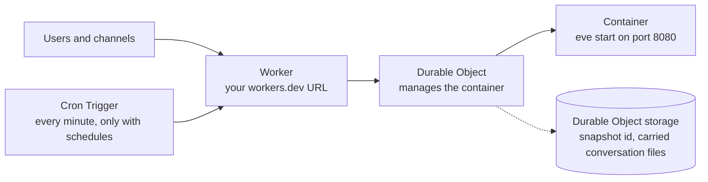

# How Eden works

Eve is built to run on Vercel. An Eve app is a long-running Node server
(`eve start`), a sandbox where the agent runs shell commands, and a Workflow
World that stores sessions, runs, and steps. A Cloudflare Worker cannot run a
long-running Node server, but a Cloudflare Container can. Eden runs your real
Eve server, unchanged, inside a Cloudflare Container on your own account, and
puts a small Worker in front of it.

This page explains the moving parts. For commands and flags see the
[reference](./reference.md); for the step-by-step guide see
[Deploy an existing Eve project](./deploy.md).

## The pieces

| Piece | What it does |
| --- | --- |
| **Worker** | Owns the public `workers.dev` URL and forwards every request to the Durable Object. It answers `404` for Eve's internal queue routes (`/.well-known/workflow/v1/flow`, `/.well-known/workflow/v1/step`) and `/__eden/world/*`, which only the container itself may call. |
| **Durable Object** | The container's manager. It starts the container, passes in your runtime variables, puts it to sleep, takes and restores disk snapshots, and carries conversation files across updates. One Durable Object per agent. |
| **Container** | Your Eve app built by your own `eve build`, started with `eve start --host 0.0.0.0 --port 8080` on a `standard-1` instance (1/2 vCPU, 4 GiB). It has outbound internet access. |
| **Cron Trigger** | Added only when `eve build` reports schedules. Wakes the container so Eve can run them. |

Eden owns the build, packaging, publishing, deployment records, and cleanup.
Eve stays the application: its providers, models, authentication, channels,
schedules, sandbox, and Workflow World are the ones your project configures.

## What `eden deploy` does

Each step prints a progress line, in this order. Nothing on Cloudflare changes
until the checks in steps 1–4 have passed.

1. **Validate the env file** (only with `--env-file`): format, reserved names,
   and that the file does not change during the run.
2. **Package the project** (`packaging project — snapshot, frozen install, eve
   build`). Eden copies your project into a throwaway Linux/amd64 Docker
   builder, leaving out `node_modules`, `.git`, build caches, your env file,
   any `.env*` file, and credential files such as `.npmrc`, `*.pem`, and
   `*.key`. Inside the builder it runs `pnpm install --frozen-lockfile` and your
   project's own `eve build`. The builder has no KVM and no Docker daemon, so
   Eve's default sandbox resolves to `just-bash` (see [Limits](#limits)).
3. **Check Cloudflare** (`checking Cloudflare access and exact target`): your
   login resolves to exactly one account, and the target name is either free
   or already owned by Eden (then this deploy is an update).
4. **Build and boot-check the image** (`building linux/amd64 runtime image,
   booting eve, checking health`). Eden builds the runtime image, starts it on
   your machine, and waits for Eve's `/eve/v1/health` to report ready.
   `eden preflight` runs the same checks and stops here, changing nothing on
   Cloudflare.
5. **Push the image** to your account's Cloudflare registry.
6. **Register runtime variables** (only with `--env-file`). Each value is
   uploaded as a Worker secret. Values never go into the image, command
   arguments, or logs. Only the names in this deploy's env file reach the
   container, so pass the same `--env-file` on every deploy. See
   [Security](./security.md).
7. **Publish** the Worker and Container application.
8. **Verify and promote** (`verifying health at <origin>`). Eden calls the
   public `/eve/v1/health` and only treats the deployment as live once it
   reports ready with the expected deployment identity. Then it removes its
   local build images and, on an update, the previous registry images, and
   prints the URL.

Eden records what it created under `.eden/eve-deploy/` in the project. That
record is how a later `deploy` proves it may update the target and how
`destroy` knows exactly what to delete.

## A request, end to end

1. A request reaches the Worker. Internal queue and World routes get `404`.
2. The Worker removes headers a client could spoof (`forwarded`, `x-real-ip`,
   `true-client-ip`, every `x-forwarded-*`, `x-eden-*`, and `cf-*` header, and
   similar), sets its own `host`, `forwarded`, and
   `x-forwarded-host`/`-port`/`-proto`, and passes the request to the agent's
   Durable Object.
3. If the container is not running, the Durable Object starts it (see
   [Sleep and wake](#sleep-and-wake)) with your runtime variables as
   environment variables.
4. Eve handles the request. Authentication and authorization are Eve's job,
   done by the authenticator in your project.
5. The response goes back through the Worker, which adds `x-eden-eve-*`
   headers naming the deployment and generation.

When Eve calls its own public URL (workflow queue deliveries do this), the
request never leaves Cloudflare: it is intercepted and delivered back into the
same container over the internal port. That is why the public queue routes can
safely return `404`.

## Sleep and wake

A Cloudflare Container's disk is wiped when it stops, and Cloudflare stops an
idle container within 6 hours of its Durable Object going idle. Eden handles
both:

- **Sleep.** After 1 hour without requests, the Durable Object snapshots the
  container's disk, then stops it. A stopped container is not billed. The
  window is configurable with `EDEN_EVE_CONTAINER_SLEEP_AFTER` up to `345m`, so
  the snapshot always happens before Cloudflare's own stop. If the snapshot
  fails 3 times, Eden stops the container anyway so billing does not run on,
  and the disk changes from that awake period are lost.
- **Wake.** The next request starts the container from the snapshot, so files
  written by the agent are still there. A wake takes about 10–15 seconds,
  mostly Eve's server starting; the container itself starts in about a second.
- Cloudflare deletes a snapshot 30 days after it was created or last
  restored. Every wake, including a scheduled one, restores the snapshot and
  resets those 30 days. If the snapshot is gone, Eden starts the container
  from the image and restores the conversation files it saved at sleep, so
  those files survive; everything else on the disk starts fresh.

## Schedules

Eve runs schedules (`agent/schedules/*`) inside its own server, which cannot
fire while the container sleeps. When your build has schedules, Eden adds one
Cron Trigger that runs every minute. Each minute the Worker checks whether any
schedule's next run falls within the next 4 minutes; if so, it sends a wake
request. Eve's own scheduler then runs the job, so each schedule fires exactly
once, in UTC, as on Vercel.

Only standard 5-field cron expressions can be checked ahead of time. Anything
else (a seconds field, `@daily`) only runs while the container happens to be
awake, and deploy warns about it. Cloudflare can take up to about 17 minutes
to start delivering a new Cron Trigger; the default 1-hour sleep keeps the
container awake through that window.

## Updates

Running `eden deploy` again on a target Eden owns updates it in place: same
Worker, same URL, same Durable Object.

1. Build, boot-check, and push the new image exactly like a first deploy.
2. Republish the Worker and Container application. Durable Object classes and
   their data are kept.
3. On the first request after the update, the Durable Object sees the
   container still runs the old image. Before stopping it, it copies every
   conversation's sandbox files
   (`/workspace/.eve/sandbox-cache/just-bash/sessions`) into Durable Object
   storage, up to 1 GiB compressed. If the container was asleep, the copy
   taken at sleep time is used.
4. The new container starts from the new image, gets the conversation files
   back before it serves any request, and the rest of `/workspace` resets to
   the new image, as on Vercel.
5. Eden health-checks the URL, promotes the new generation, and deletes the
   previous generation's registry images.

If copying the conversation files fails, the update still goes ahead and
those conversations lose their sandbox files.

Eve rejects resuming a just-bash conversation after a skill change
([eve#4440](https://github.com/vercel/eve/issues/4440)). Eden's builder applies
a small temporary fix to Eve's just-bash binding inside the throwaway build
container only, and only when the file matches a checksum Eden recognizes.
On an unrecognized Eve version the deploy still succeeds and prints an
`EVE_SANDBOX_RESUME_PATCH` warning.

On Vercel each run stays on the deployment that started it. Off Vercel there
is no pinning: sessions, pending approvals, and sleeping steps that started
before an update continue on the new code (`EVE_UPDATE_IN_FLIGHT`). Keep step
names and state shapes backward-compatible until older runs finish.

## Where your data lives

| Data | Where | Survives sleep | Survives update | Survives destroy |
| --- | --- | --- | --- | --- |
| Agent files in the container (`/workspace`) | Container disk, saved in Cloudflare snapshots | Yes (snapshot expires after 30 idle days) | Only conversation sandbox files, up to 1 GiB compressed | No |
| Workflow state, default local World | Container disk | Yes | No: it resets, and deploy warns | No |
| Workflow state, Postgres World | Your Postgres database | Yes | Yes | Yes |
| Workflow state, Eden Cloudflare World (experimental) | A Durable Object on your account | Yes | Yes | No |
| Runtime variables | Worker secrets on your account | Yes | Only the names in this deploy's `--env-file` reach the new container | No |
| Deployment records | `.eden/eve-deploy/` in your project, on your machine | n/a | Updated | Kept locally |

For durable state across updates, use the Postgres World; see
[Durable state (Postgres World)](./deploy.md#durable-state-postgres-world).

## Destroy

`eden destroy --name <target>` reads Eden's record for that exact target,
checks that the live Worker and Container application still match it, deletes
only those plus the registry images the records prove Eden pushed, and then
verifies they are gone. It never matches by name prefix or searches your
account, so similarly named resources are never touched. Data in the Durable
Object (including the experimental Cloudflare World) is deleted with the
Worker; a Postgres database is yours and is not touched.

Because ownership comes from the records in `.eden/eve-deploy/`, a different
clone or machine without those records cannot update or destroy the target;
Eden reports a target conflict instead of guessing.

## Limits

- **Sandbox:** `just-bash`, a simulated shell. Files, `grep`/`sed`/`jq`/
  `sqlite3`, and `curl` work; `python`, `git`, `npm`, and other real programs
  do not. Eve prepares its sandbox during `eve build`, and a real Linux
  sandbox (microsandbox or Docker) needs KVM or a Docker daemon on the build
  machine, which Eden's builder does not have. microsandbox does run inside a
  Cloudflare container, but preparing it there added about 7 minutes to every
  deploy in testing, so Eden does not use it yet. The sandbox has unrestricted
  internet access.
- **Scale:** one container per agent, `workers.dev` URL only. No horizontal
  scaling or custom domains yet.
- **Plan:** Cloudflare Containers need the Workers Paid plan.

Return to the [documentation index](./README.md).
