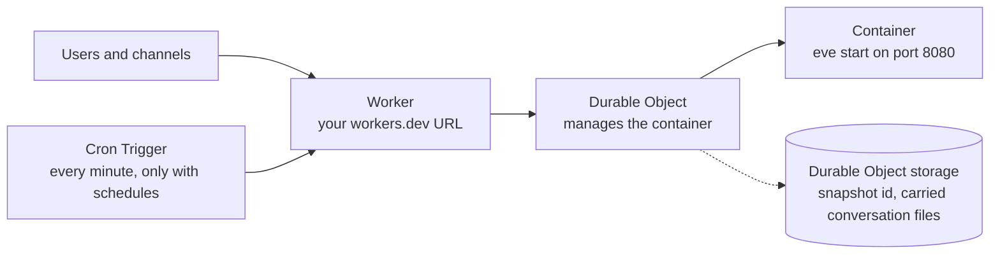

# How Eden works

Eve is built to run on Vercel. An Eve app is a long-running Node server
(`eve start`), a sandbox where the agent runs shell commands, and a Workflow
World that stores sessions, runs, and steps. A Cloudflare Worker cannot run a
long-running Node server, but a Cloudflare Container can. Eden runs your real
Eve server, unchanged, inside a Cloudflare Container on your own account, and
puts a small Worker in front of it.

This page explains the moving parts. For commands and flags see the
[reference](./reference.md); for the step-by-step guide see
[Deploy an existing Eve project](./deploy.md).

## The pieces

| Piece | What it does |
| --- | --- |
| **Worker** | Owns the public `workers.dev` URL and forwards every request to the Durable Object. It answers `404` for Eve's internal queue routes (`/.well-known/workflow/v1/flow`, `/.well-known/workflow/v1/step`) and `/__eden/world/*`, which only the container itself may call. |
| **Durable Object** | A deployment's container manager. It starts the container, passes in runtime variables, sleeps it independently, takes and restores disk snapshots, and carries conversation files. Affinity-enabled targets can retain several deployment managers. |
| **Container** | Your Eve app built by your own `eve build`, started with `eve start --host 0.0.0.0 --port 8080` on a `standard-1` instance (1/2 vCPU, 4 GiB). It has outbound internet access. |
| **Cron Trigger** | Added only when `eve build` reports schedules. Wakes the container so Eve can run them. |

Eden owns the build, packaging, publishing, deployment records, and cleanup.
Eve stays the application: its providers, models, authentication, channels,
schedules, sandbox, and Workflow World are the ones your project configures.

## What `eden deploy` does

Each step prints a progress line, in this order. Nothing on Cloudflare changes
until the checks in steps 1–4 have passed.

1. **Validate the env file** (only with `--env-file`): format, reserved names,
   and that the file does not change during the run. Eden then checks the
   Eve version, the sandbox module, and your Cloudflare login
   (`checking Cloudflare access`), and stops here with every problem it
   found if one of them fails.
2. **Package the project** (`packaging project — snapshot, frozen install, eve
   build`). Eden copies your project into a throwaway Linux/amd64 Docker
   builder, leaving out `node_modules`, `.git`, build caches, your env file,
   any `.env*` file, and credential files such as `.npmrc`, `*.pem`, and
   `*.key`. Inside the builder it runs the exact-pinned npm version (default
   `11.13.0` when undeclared, npm 7 or newer when pinned) with frozen
   `npm ci --ignore-scripts --no-audit --no-fund` (no dependency lifecycle
   scripts), or the exact-pinned `pnpm install --frozen-lockfile`, then your
   project's own `eve build`.
   Private registries and project `.npmrc`-dependent installs are unsupported.
   Eden asks each image build to load its result into Docker
   (`docker build --load`, when Docker Buildx is installed), so the builder
   Docker has selected can use the `docker` or the `docker-container` driver.
   The builder has no Docker daemon. Select `JustBashSandbox` in the project;
   Eden rejects the production default and other providers rather than
   substituting one.
3. **Check Cloudflare** (`checking Cloudflare access and exact target`): your
   login resolves to exactly one account, and the target name is either free
   or already owned by Eden (then this deploy is an update).
4. **Build and boot-check the image** (`building linux/amd64 runtime image,
   booting eve, checking health`). Eden builds the runtime image, starts it on
   your machine on a free local port that Docker picks, and waits for Eve's
   `/eve/v1/health` to report ready. The boot container is removed whether
   the check passes or fails.
   `eden preflight` runs the same checks and stops here, changing nothing on
   Cloudflare.
5. **Push the image** to your account's Cloudflare registry. From here on,
   Wrangler runs every command with the account from step 3, so a login
   that changes mid-deploy cannot move a write to another account. Step 3
   itself runs before the build and again after it, and the deploy stops if
   the two name different accounts.
6. **Register runtime variables** (only with `--env-file`). Each value is
   uploaded as a Worker secret. Values never go into the image, command
   arguments, or logs. Only the names in this deploy's env file reach the
   container, so pass the same `--env-file` on every deploy. See
   [Security](./security.md).
7. **Publish** the Worker and Container application. Eden runs
   `wrangler deploy` once. When Wrangler uploads the Worker version and
   then fails at the Container application settings, the deploy ends
   `DEPLOY_INDETERMINATE` and says so.
8. **Verify and promote** (`verifying health at <origin>`). Eden calls the
   public `/eve/v1/health` and only treats the deployment as live once it
   reports ready with the expected deployment identity. Then it removes its
   local build images and prints the URL. Registry images needed by retained
   deployments are not deleted merely because a newer release is live.

Eden records what it created under `.eden/eve-deploy/` in the project. That
record is how a later `deploy` proves it may update the target and how
`destroy` knows exactly what to delete.

On later deploys, Eden removes old versions once their sessions end and their
queued work and file transfers finish. The version replaced by this deploy
stays until at least the next deploy. Cloudflare can keep inactive instance
records until destroy.

Eden keeps at most 10 versions, including the current and legacy versions.
If cleanup cannot make room, deploy refuses and lists the blocking versions
and live session counts. There is no override flag.

## A request, end to end

1. A request reaches the Worker. Internal queue and World routes get `404`.
2. The Worker removes headers a client could spoof (`forwarded`, `x-real-ip`,
   `true-client-ip`, every `x-forwarded-*`, `x-eden-*`, and `cf-*` header, and
   similar), sets its own `host`, `forwarded`, and
   `x-forwarded-host`/`-port`/`-proto`, and passes public ingress to the newest
   deployment's Durable Object.
3. If the container is not running, the Durable Object starts it (see
   [Sleep and wake](#sleep-and-wake)) with your runtime variables as
   environment variables.
4. Eve handles the request. Authentication and authorization are Eve's job,
   done by the authenticator in your project.
5. The response goes back through the Worker, which adds `x-eden-eve-*`
   headers naming the deployment and generation.

When Eve calls its own public URL (workflow queue deliveries do this), the
request never leaves Cloudflare: it is intercepted and delivered back into the
same container over the internal port. That is why the public queue routes can
safely return `404`.

With the Cloudflare World, queued work goes to the version that needs to run
it, even after an upgrade. Deliveries run independently, so a long task does
not block another session. Eve does not authenticate these deliveries; the
World says so with `queueAuthMode: "skip"`, because the Worker keeps the
queue routes closed to the internet.

## Sleep and wake

A Cloudflare Container's disk is wiped when it stops, and Cloudflare stops an
idle container within 6 hours of its Durable Object going idle. Eden handles
both:

- **Sleep.** After 1 hour without requests, the Durable Object snapshots the
  container's disk, then stops it. A stopped container is not billed. The
  window is configurable with `EDEN_EVE_CONTAINER_SLEEP_AFTER` up to `345m`, so
  the snapshot always happens before Cloudflare's own stop. If the snapshot
  fails 3 times, Eden stops the container anyway so billing does not run on,
  and the disk changes from that awake period are lost.
- **Wake.** The next request starts the container from the snapshot, so files
  written by the agent are still there. A wake takes about 10–15 seconds,
  mostly Eve's server starting; the container itself starts in about a second.
- Cloudflare deletes a snapshot 30 days after it was created or last
  restored. Every wake, including a scheduled one, restores the snapshot and
  resets those 30 days. If the snapshot is gone, Eden starts the container
  from the image and restores the conversation files it saved at sleep, so
  those files survive; everything else on the disk starts fresh.

With deployment affinity, each retained instance has its own sleep/wake
lifecycle. Eden never sleeps an instance during an in-flight delivery or
file transfer; keeping an image retained does not require keeping it awake.

## Schedules

Eve runs schedules (`agent/schedules/*`) inside its own server, which cannot
fire while the container sleeps. When your build has schedules, Eden adds one
Cron Trigger that runs every minute. Each minute the Worker checks whether any
schedule's next run falls within the next 4 minutes; if so, it sends a wake
request. Eve's own scheduler then runs the job in UTC, as on Vercel.

Old versions start with schedules disabled. If an old version is still
running work when you upgrade, its schedules stop only after that work and
any file transfers finish. A scheduled job can fire on both versions during
that window.

Only standard 5-field cron expressions can be checked ahead of time. Anything
else (a seconds field, `@daily`) only runs while the container happens to be
awake, and deploy warns about it. Cloudflare can take up to about 17 minutes
to start delivering a new Cron Trigger; the default 1-hour sleep keeps the
container awake through that window.

## Updates

Running `eden deploy` again on an owned target keeps the same Worker and URL.
The project's installed World must declare `deploymentAffinity` to preserve
sessions across Eve upgrades. Update both the CLI and the World package;
updating the CLI alone is not enough. Older Worlds keep the previous update
behavior and the warning that an Eve upgrade can strand sessions.

- **The version switch:** Cloudflare does not move the Worker and its
  Durable Objects to the new version at the same instant. On 2026-11-20
  they ran different releases for between half a second and 20 seconds, in
  either order. Each caller stamps its release ID on a request, with the
  release it replaced. `eden deploy` reads the replaced release from the
  live Worker's settings when it starts, not from the local record.
  - A Container object and the World object serve their own release and
    the one they replaced.
  - An object resets itself only for the release that names it as the one
    it replaced. That proves the caller is newer, and the object restarts
    on the new code. Any other release gets `503` with `Retry-After: 5`
    and no reset, so two releases cannot reset each other. Such an object
    changes version when Cloudflare moves it.
  - A reset says nothing about whether a request in flight ran. Eden
    repeats only a GET or HEAD, and the health read it sends before any
    other request. It never sends a POST, PUT, PATCH or DELETE twice, and
    never a World call: when a reset loses the answer, the client or Eve
    gets `503` with `Retry-After: 1` and the request may have run.
  - A reset object can come back on the old code until Cloudflare has the
    new version where the object runs. The Worker starts no new try later
    than 30 seconds after the request arrived, then answers `503` with
    `Retry-After: 5`. This covers every object the request needs,
    including a retained version's object. The wait for a starting
    Container is separate and unchanged.
  - If a Worker of the replaced release names a version the new release no
    longer routes, the object answers `503` with `Retry-After: 1`.
  - Requests that arrive while the object replaces the Container wait for
    the one new Container.
  - The first request of a release, which is the deploy's health check,
    also asks the World object to place the release. So `eden deploy`
    reports healthy only after a World object on the replaced release has
    restarted. A World object deployed by Eden `0.13.0` or earlier does
    not have this check: after the first Eve upgrade made with a newer
    CLI it can keep the old list of versions until Cloudflare moves it,
    2 minutes 20 seconds when measured, and new sessions get Eve's
    `500` for that time although the deploy reported healthy.

  Two deploys of one target that overlap can both name the same replaced
  release. The objects of the one published last then answer `503` to the
  other's Workers until Cloudflare has switched them all. Eden does not
  lock a target against a second deploy.

  What can still return Cloudflare's error 1101 page (HTTP 500) around a
  switch: Cloudflare's own Durable Object errors, such as "Internal error
  in Durable Object storage caused object to be reset", which Eden does not
  retry. The measurements are in the
  [compatibility history](./eve-compatibility-history.md). Two earlier HTTP
  500 answers, at least 20 seconds after a switch, left no log and are not
  proven to have one of these causes.
- **Same Eve version:** update in place. Eden carries
  `/workspace/.eve/sandbox-cache/just-bash/sessions` through Durable Object
  storage, up to 1 GiB compressed (using the sleep-time copy if asleep).
  Conversation files return before requests are served; other workspace files
  reset to the new image.
- **New Eve version:** start a new container and keep the old version running
  for existing sessions. A session's next message moves it to the new version
  with the same ID, history, and sandbox files. Idle sessions move without a
  message. Running work finishes on the old version.
- **Targets deployed with Eden `0.9.0`:** existing sessions stay on the old
  version until they end. They do not move to the new version.
- **Cleanup:** a session's first run stays on its original version until the
  session ends, so that version is kept even after the session moves. A later
  deploy removes versions no longer needed by sessions, work, or transfers.
- **Registry images:** every image Eden pushes gets a tag of its own, the
  release ID Eden generates for that deploy (`eve-deploy-<uuid>`). A
  same-version update pushes into the repository of the image it replaces.
  Once the new deployment is healthy and promoted, Eden deletes the
  replaced image by its tag, and Cloudflare's registry then removes the
  image. Eden never deletes it earlier. It takes the replaced image's
  repository, digest and release tag from the deployment record, and
  deletes the tag only when the registry resolves it to that digest. It deletes nothing when the
  repository also holds the image of a kept version or of a version whose
  retirement the record still names. If the delete cannot be shown, the
  update still succeeds with the warning
  [`EVE_SUPERSEDED_IMAGE_NOT_DELETED`](./troubleshooting.md#eve_superseded_image_not_deleted).
  A later deploy does not try that image again. `eden destroy`, and the
  retirement of that Eve version after an upgrade, try to delete everything
  the repository lists.
- **Targets deployed with Eden `0.13.x` or older:** those versions pushed
  every image under the tag `candidate`, so each same-version update took
  the tag from the image before it. Cloudflare's registry does not remove an
  image that no tag names. This version still updates and destroys such a
  target, and it never deletes or moves `candidate`. Its first same-version
  update pushes under a release tag and leaves the replaced image under
  `candidate`: `VAL-LIFE-007` is `skipped`. That image stays, still tagged,
  until `eden destroy` or the retirement of that Eve version deletes
  everything in the repository. From the second update on, the replaced
  image goes at once. The images that had already lost the tag stay, and
  `eden destroy` reports them as `accepted-still-listed` in
  [`EVE_REGISTRY_OBJECTS_KEPT`](./troubleshooting.md#eve_registry_objects_kept).

If the same-version restart's conversation-file copy fails, the update still
goes ahead and those conversations lose their sandbox files. File transfers
between versions can instead be retried without overwriting active files.

The historical `0.82.0` → `0.83.0` upgrade returned HTTP 409
`session_stranded` with an older World. See
[Eve compatibility history](./eve-compatibility-history.md#eve-0820-to-0830-live-upgrade-2026-10-23).

Same-version updates still resume sessions, pending approvals, and sleeping
steps on new code (`EVE_UPDATE_IN_FLIGHT`). Keep step names and state shapes
backward-compatible until older runs finish. Worlds without affinity have
the same in-place compatibility requirement.

## Where your data lives

| Data | Where | Survives sleep | Survives update | Survives destroy |
| --- | --- | --- | --- | --- |
| Agent files in the container (`/workspace`) | Container disk, saved in Cloudflare snapshots | Yes (snapshot expires after 30 idle days) | Only conversation sandbox files, up to 1 GiB compressed | Not in the container. A snapshot that Cloudflare keeps still holds them for about 30 days |
| Workflow state, default local World | Container disk | Yes | No: it resets, and deploy warns | Not in the container. A snapshot that Cloudflare keeps still holds it for about 30 days |
| Workflow state, Postgres World | Your Postgres database | Yes | Yes | Yes |
| Workflow state, Eden Cloudflare World (experimental) | A Durable Object on your account | Yes | Yes | No |
| Runtime variables | Worker secrets on your account | Yes | Only the names in this deploy's `--env-file` reach the new container | No |
| Deployment records | `.eden/eve-deploy/` in your project, on your machine | n/a | Updated | Kept locally |

For durable state across updates, use the
[Cloudflare World](./deploy.md#durable-state-on-cloudflare-no-database) or
[Postgres World](./deploy.md#durable-state-postgres-world).

## Destroy

`eden destroy --name <target>` reads Eden's record for that exact target,
checks that the live Worker and Container application still match it, deletes
them and every retained container instance the records prove Eden owns.
It cleans up their registry repositories, except for
[objects Cloudflare keeps](./troubleshooting.md#eve_registry_objects_kept).
This includes legacy deployments and does not wait for sessions to drain.
It never matches by name
prefix or searches your account, so similarly named resources are never
touched. Data in the Durable Object (including the experimental Cloudflare
World) is deleted with the Worker; your Postgres database is not touched.

Destroy acts only on evidence it read itself. It asks Wrangler which account
is signed in, and reads the Worker and the Container application from
Cloudflare's API under that account. If that is not the account in the
record, it reads nothing. A Worker is absent only when the API answers
status `404` with `success` false, a null result, the single error code
`10007`, and no field named twice. A Container application list counts
only with status `200`, `success` true, an empty `errors` list, and no
field named twice. A failed or unclear read of either stops destroy with
`EVE_DESTROY_INDETERMINATE` and leaves the record alone. Wrangler runs each delete with the recorded
account set. Destroy reads everything again after its deletes and clears
the `CURRENT` pointer only if it is the symlink that named the record and
is still the file it read at the start. That check and the removal are two steps, not one atomic step. Destroy
also cannot stop a deploy of the same Worker from another folder or machine,
so absence is proven at the time of the last read.

Destroy tries to delete everything
Cloudflare's registry lists for the target's repositories: every tag, and
every `sha256:` entry, which the registry lists for each manifest.
Cloudflare keeps three kinds of object (observed on 2026-11-18). Its
registry refuses to delete a container snapshot. It refuses to delete the
chain artifact that Cloudflare makes for each pushed image. And it can
accept the delete of a manifest and still list it at least 30 seconds
later, which was seen for an earlier image with no tag. Destroy lists each
kept object, with the registry's answer, in the warning
`EVE_REGISTRY_OBJECTS_KEPT`. It clears the target's local pointer only
after a final listing, read in full, shows nothing else. Cloudflare
documents that it removes a snapshot 30 days after it was created or last
restored. Until then the snapshot still holds the container's disk,
including the agent's files and the default local World's state. When
Cloudflare removes the other two kinds is not known. A deploy that removes
a superseded version's registry repository cleans up the same way and
reports the same warning. It deletes nothing from a repository that holds
an image that is still deployed.

Updates and `destroy` need the `.eden/` folder the deploy wrote. Run from the
project root that holds it, or select that root with `--project`. Keep it out
of git. Without the records, an update reports a target conflict and destroy
reports `EVE_DESTROY_RECORD_UNPROVEN`. If the folder is lost, see
[The `.eden/` folder is lost](./troubleshooting.md#the-eden-folder-is-lost).

## Limits

- **Sandbox:** `just-bash`, a simulated shell. Files, `grep`/`sed`/`jq`/
  `sqlite3`, and `curl` work; `python`, `git`, `npm`, and other real programs
  do not. Eve prepares its sandbox during `eve build`. Eden's builder has no
  Docker daemon, so projects must
  [explicitly select `JustBashSandbox`](./deploy.md#sandbox-setup); its
  production default does not fall back. Other providers are unsupported.
  On older Eve releases, Eden hid `/dev/kvm` to avoid selecting
  microsandbox. Historical preparation of microsandbox inside a Cloudflare
  container added about 7 minutes per deploy in testing; Eve `0.83.0` removed
  that provider. The sandbox has unrestricted internet access.
- **Scale:** one container instance per kept version (one per agent without
  affinity), up to 10 versions; `workers.dev` URL only. No horizontal scaling
  or custom domains yet.
- **Plan:** Cloudflare Containers need the Workers Paid plan.

Return to the [documentation index](./README.md).
