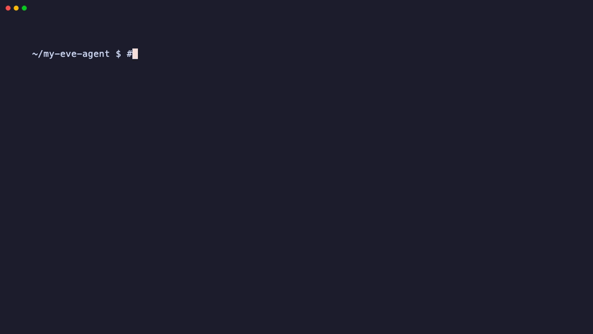

# Eden

Eden deploys an existing [Vercel Eve](https://github.com/vercel/eve) project to
your own Cloudflare account through one CLI.



If you already have an Eve project, start with `eden deploy`.

## Install

Use any one of these package managers:

```sh
npm install --global @moinulmoin/eden
```

```sh
pnpm add --global @moinulmoin/eden
```

```sh
bun add --global @moinulmoin/eden
```

Then confirm the CLI is available:

```sh
eden --version
```

Bun can install Eden, but Eden still runs on Node. Do not use `bunx --bun`.

## Requirements

- macOS or Linux
- Node `^24.22.0 || ^26.12.0`
- a Cloudflare account on the Workers Paid plan (required for Containers)
- a sign-in with Cloudflare's `cf` CLI, or `CLOUDFLARE_API_TOKEN` set:

  ```sh
  npx cf@1.0.0-rc.2 auth login
  ```

- Docker or OrbStack with Linux/amd64 container support
- an Eve project on `0.91.0` or later, with one root `package-lock.json` or
  an exact `packageManager: "pnpm@..."` pin and matching `pnpm-lock.yaml`
- `just-bash` as a production dependency, selected explicitly in
  `agent/sandbox.ts` (or `agent/sandbox/sandbox.ts` if that folder exists)
- any providers, databases, Workflow World, credentials, and external services
  already required by that Eve project

Bun project lockfiles and native Windows are not supported.

## Deploy an existing Eve project

From inside the Eve project:

```sh
npx @moinulmoin/eden deploy
```

With no flags, `deploy` uses the current directory, the `preview`
environment, and a target name derived deterministically from the project's
`package.json` name. Deploy performs its checks inline, installs the
project's npm or pinned pnpm lockfile, runs its project-local Eve executable,
packages the real Eve server into one Cloudflare Container, and publishes one
Worker in front of it.

Explicit selectors still work, and `--name` is required for `--env
production` and `destroy`:

```sh
eden deploy \
  --project ./my-eve-app \
  --env preview \
  --name my-eve-preview
```

A successful command prints progress lines followed by a summary with the
target, the Eve version, and its `workers.dev` URL on its own line. Eden does not
change the source directory. All three commands accept `--json` for the
machine-readable result object, for scripts and CI.

If the Eve project needs runtime values, put them in a regular owner-readable
environment file outside source control:

```sh
eden deploy \
  --project ./my-eve-app \
  --env preview \
  --name my-eve-preview \
  --env-file ~/.config/my-eve-app/preview.env
```

`eden preflight` is an optional diagnostic that changes nothing on
Cloudflare. You do not need to run it before `deploy`:

```sh
eden preflight \
  --project ./my-eve-app \
  --env preview \
  --name my-eve-preview
```

Ship a change by running the same deploy again. Eden updates the target it
owns in place: same Worker and URL, the new code, and every conversation's
sandbox files carried into the new Container.

Remove exactly that deployment when finished:

```sh
eden destroy --name my-eve-preview
```

Destroy always requires an explicit `--name`. It verifies Eden's ownership
record and the current remote identity before removing anything. It never
deletes by prefix or broad account search. Cloudflare may keep some
[registry objects](https://github.com/moinulmoin/eden/blob/main/docs/troubleshooting.md#eve_registry_objects_kept).

## Command map

| Command | Purpose |
| --- | --- |
| `eden preflight` | Build and inspect an Eve candidate without remote mutation |
| `eden deploy` | Deploy an existing Eve project to one exact target, or update one Eden owns in place |
| `eden destroy` | Remove one exact Eden-owned Eve deployment |

Run `eden <command> --help` for command-specific options.

## What Eden does not do

- Deploy does not replace the Eve project's providers, databases, Workflow
  World, authentication, schedules, or channels.
- The agent's sandbox is `just-bash`, a simulated shell, not a real Linux VM
  like Vercel Sandbox. Files, `grep`/`sed`/`jq`/`sqlite3`, and `curl` work;
  `python`, `git`, and `npm` do not. A sandbox Dockerfile cannot provide a
  Linux VM on Eden.
- Container files survive sleep via snapshots, and image updates now carry
  Eve's sandbox sessions — every conversation's files — across the image
  change through the Durable Object's storage (capped at 1 GiB compressed).
  The rest of `/workspace` still resets to the new image. Durable Workflow
  state across updates needs a project-configured
  World, such as Postgres or `@moinulmoin/eden-world-cloudflare`.
- Standard 5-field cron schedules wake the Container; unsupported cron forms
  only run while it is awake.
- This release uses one Container instance per kept version (`standard-1`, 1/2 vCPU,
  4 GiB) and does not promise horizontal scaling or custom domains.
- Bun is an installer only; Node remains the runtime.

## Documentation

- [Documentation index](https://github.com/moinulmoin/eden/blob/main/docs/README.md)
- [Installation](https://github.com/moinulmoin/eden/blob/main/docs/install.md)
- [Deploying Eve projects](https://github.com/moinulmoin/eden/blob/main/docs/deploy.md)
- [How Eden works](https://github.com/moinulmoin/eden/blob/main/docs/how-it-works.md)
- [Security](https://github.com/moinulmoin/eden/blob/main/docs/security.md)
- [FAQ](https://github.com/moinulmoin/eden/blob/main/docs/faq.md)
- [Reference](https://github.com/moinulmoin/eden/blob/main/docs/reference.md)
- [Troubleshooting](https://github.com/moinulmoin/eden/blob/main/docs/troubleshooting.md)
- [Validation and cleanup](https://github.com/moinulmoin/eden/blob/main/docs/validation.md)

## License

Apache-2.0. The package includes `LICENSE` and `NOTICE` with the applicable Eve
and Cloudflare attribution.
